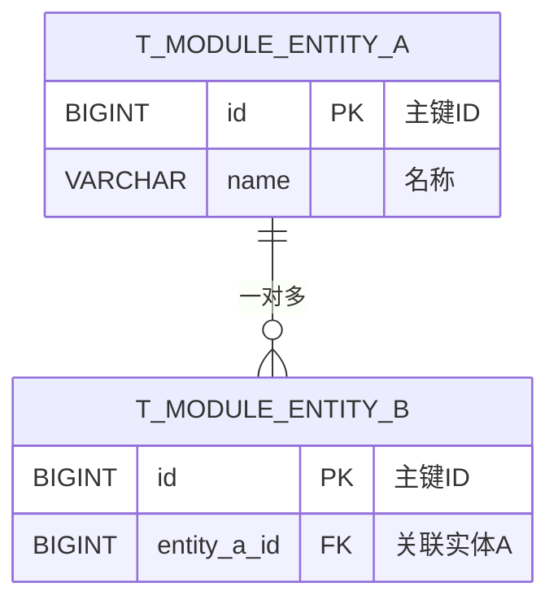

# DDL 设计

## 目标

基于详细设计中的数据模型概要，产出完整的数据库 DDL，包括 ER 图、表结构定义、字段约束、索引设计、中文注释、数据迁移策略。

## 产出物充分性要求

**一个 DBA 或后端工程师拿到本文档后必须能够：**

- 通过 ER 图快速理解整体数据模型和表间关系
- 直接复制 DDL 到数据库客户端执行建表，无需修改
- 理解每个表的业务用途和每个字段的含义（所有注释均为中文）
- 理解索引设计的依据（为哪些查询场景设计）
- 在现有系统迭代场景下，知道如何执行数据迁移和备份恢复

**重要：必须同时生成两个产出物：**

1. ✅ `docs/` 目录下的 Markdown 设计文档
2. ✅ `db/` 目录下的可执行 SQL 脚本文件（可直接在数据库客户端运行）

## 前置条件

- `docs/{需求名}/01-详细设计/01-详细设计.md` 已存在且经用户确认
- 已在 backend-dev 启动阶段确认数据库类型

## 执行步骤

### ⚠️ Step 0：制定执行计划并和用户确认

**每次执行本 skill 前必须执行此步骤。**

1. 先阅读所有前置文档，理解需求
2. 制定详细的执行计划，包括：
   - 具体步骤
   - 每步做什么
   - 产出物是什么
3. 计划文件保存到：`docs/{需求名}/02-DDL设计/00-计划与执行.md`

### Step 4: 把计划展示给用户，确认无误后再开始执行

1. 执行过程中实时更新进度到该文件

计划文件格式：

```markdown
# DDL设计 计划与执行

## 计划
| 步骤 | 内容 | 产出物 |
|------|------|--------|
| 1 | ... | ... |
| 2 | ... | ... |
| ... | ... | ... |

## 进度跟踪
| 步骤 | 状态 | 完成时间 |
|------|------|----------|
| 1 | ⬜ 未开始 | |
| 2 | ⬜ 未开始 | |
| ... | ... | ... |

## 执行日志
### [YYYY-MM-DD]
- 完成了：...
- 遇到的问题：...
- 下一步：...
```

### Step 1: 加载数据库特定模板

：根据项目使用的数据库，从 `references/` 加载对应模板：

- 达梦8 → `references/dameng8.md`
- MySQL → `references/mysql.md`
- PostgreSQL → `references/postgresql.md`
- 其他数据库 → 向用户确认语法差异和类型映射规则

### Step 2: 阅读数据模型概要

：从详细设计文档中提取实体、关系、主要字段信息。

### Step 3: 绘制 ER 图

：使用 Mermaid erDiagram 语法绘制实体关系图，标注实体间的关系类型（一对一、一对多、多对多）和关联字段。

### Step 4: 设计表结构

：为每个实体设计完整的表结构，包含所有字段、类型、约束。

### Step 5: 设计索引

：根据查询场景设计索引（主键、唯一索引、普通索引、组合索引），**每个索引必须标注服务于哪个查询场景**。

### Step 6: 编写 DDL 语句

：按加载的数据库模板编写建表语句，**表和字段都必须添加中文注释**。

### Step 7: 数据安全审查

：阅读 `backend-dev/references/security/security-features.md` 中"数据保护"章节，确认敏感字段（密码、个人信息、密钥等）的存储加密方案，确认需要脱敏展示的字段已在 DDL 注释中标注。

### Step 8: 数据迁移策略

（仅在现有系统迭代时执行）：为每个表的变更设计迁移脚本（新增表、新增字段、修改字段类型、数据回填等）。详见下方"数据迁移策略"章节。

### Step 9: 备份恢复考虑

：在文档中标注哪些表含有核心业务数据，需要重点备份；哪些表可以从其他数据源重建。

### Step 10: 审查兼容性

：检查 DDL 是否符合目标数据库的语法和类型规范。

### Step 11: Markdown 格式检查

调用 `markdown-lint` skill 对本阶段产出的 Markdown 文档进行格式检查并自动修复。

### Step 12: 用户确认

：将 DDL 呈现给用户，确认后写入文件。

### Step 13: 生成可执行 SQL 文件

：将完整的建表语句、索引语句等写入 `db/` 目录下的独立 SQL 文件（可直接执行）。

## 通用命名规范

| 对象 | 规则 | 示例 |
|------|------|------|
| 表名 | `t_模块_实体`，小写下划线 | `t_sys_user`、`t_order_item` |
| 字段名 | 小写下划线 | `user_name`、`create_time` |
| 主键索引 | 自动 | PRIMARY KEY |
| 唯一索引 | `uk_表名_字段` | `uk_t_sys_user_login_name` |
| 普通索引 | `idx_表名_字段` | `idx_t_order_create_time` |
| 组合索引 | `idx_表名_字段1_字段2` | `idx_t_order_status_time` |

## 通用字段（所有数据库一致）

每张表须包含以下公共字段（具体类型由数据库模板定义）：

| 字段 | 用途 |
|------|------|
| id | 主键 |
| create_by | 创建人 |
| create_time | 创建时间 |
| update_by | 更新人 |
| update_time | 更新时间 |
| del_flag | 删除标记（0-正常 1-删除） |
| remark | 备注 |

## 数据迁移策略

**适用场景**：现有系统迭代，涉及表结构变更或数据回填。

**迁移脚本设计原则**：

### Step 1: 幂等性

：脚本可重复执行不产生副作用（使用 `IF NOT EXISTS` 或检查后执行）

### Step 2: 向前兼容

：新增字段设置默认值或允许 NULL，避免破坏旧代码

### Step 3: 可回滚

：提供回滚脚本，出问题可撤销变更

### Step 4: 分步执行

：大数据量的表结构变更分为多步——先加字段（允许 NULL）→ 再回填数据 → 最后加 NOT NULL 约束

**迁移脚本组织**：

```
sql/
├── ddl/
│   ├── v1.0/                      初始建表
│   │   ├── 001_create_tables.sql
│   │   └── 002_initial_data.sql
│   └── v1.1/                      迭代变更
│       ├── 001_add_column.sql     新增字段
│       ├── 002_backfill.sql       数据回填
│       ├── 003_add_constraint.sql 补充约束
│       └── 999_rollback.sql       回滚脚本
```

**迁移脚本模板**：

```sql
-- 迁移编号：v1.1-001
-- 变更说明：为 t_order 表新增 priority 字段
-- 执行顺序：1/3（后续需执行 002_backfill.sql、003_add_constraint.sql）
-- 预计耗时：< 1 秒（仅元数据变更）
-- 是否可回滚：是（见 999_rollback.sql）

-- 幂等性检查 + 执行变更
-- （具体语法参考数据库模板）

-- 回滚语句（放在对应的 rollback.sql 中）
```

## 备份恢复策略

在 DDL 文档中为每张表标注：

| 类别 | 说明 | 备份策略建议 |
|------|------|-------------|
| 核心业务表 | 丢失会导致业务不可恢复 | 全量备份 + 增量备份，异地存储 |
| 配置数据表 | 变化少，可从代码或文档重建 | 定期全量备份即可 |
| 日志审计表 | 数据量大，合规要求保留 | 按周期归档，冷热分离 |
| 临时/缓存表 | 可重建 | 无需备份 |

## 输入输出

- 输入:
  - `docs/{需求名}/01-详细设计/01-详细设计.md`
  - `references/{数据库}.md` 按需加载
- 输出:
  - 完整的 DDL 文档（含 ER 图、建表语句、索引、迁移策略、备份说明）
  - **必须生成可执行的 SQL 脚本文件**（不仅在文档里）
- 产出物位置:
  - `docs/{需求名}/02-DDL设计/02-DDL设计.md`
  - `db/` 目录下的可执行 SQL 文件（如 `db/xxx_tables.sql`、`db/xxx_init.sql` 等）

## 产出物格式

```markdown
# DDL 设计

## 数据库信息
- 数据库类型：[达梦8 / MySQL / PostgreSQL / 其他]
- 字符集 / 排序规则：[具体值]
- 模式/数据库名：[具体值]

## ER 图



## 表清单

| 序号 | 表名 | 中文名 | 业务类别 | 备份策略 | 关联表 |
|------|------|--------|----------|---------|--------|
| 1 | t_xxx_yyy | ... | 核心业务/配置/日志/临时 | ... | ... |

## 表结构与 DDL

### 1. t_xxx_yyy（中文名）

**业务说明**：[这张表存什么数据，在业务中扮演什么角色]

**字段说明**：

| 字段名 | 类型 | 必填 | 默认值 | 敏感级别 | 说明 |
|--------|------|------|--------|----------|------|
| id | BIGINT | 是 | - | - | 主键 |
| phone | VARCHAR(20) | 否 | - | 敏感-展示脱敏 | 手机号 |
| password | VARCHAR(200) | 是 | - | 敏感-加密存储 | 密码（BCrypt） |

**索引设计**：

| 索引名 | 类型 | 字段 | 查询场景 |
|--------|------|------|----------|
| idx_xxx | 普通索引 | field1 | [服务于什么查询] |

**DDL**：
（完整的可直接执行的 CREATE TABLE + 注释 + 索引语句）

## 数据迁移（仅迭代场景）

### v1.1 变更清单

| 迁移编号 | 变更说明 | 影响表 | 执行顺序 | 预计耗时 | 可回滚 |
|----------|----------|--------|----------|---------|------|
| v1.1-001 | 新增 priority 字段 | t_order | 1/3 | < 1s | 是 |

### 迁移脚本

（按顺序列出每个脚本的内容）

## 表关系说明

[用文字补充 ER 图中未能表达的关联逻辑、级联规则、业务约束等]

```

## 验收标准

- [ ] 执行计划已制定且用户已确认（Step 0）
- [ ] 已加载对应数据库的参考模板
- [ ] 提供了 Mermaid 格式的 ER 图，能清晰展示表间关系
- [ ] 每个实体都有对应的建表 DDL
- [ ] **所有表和字段都有中文注释**，枚举字段列出所有可选值
- [ ] 每个字段标注了敏感级别（一般/敏感-加密/敏感-脱敏）
- [ ] 每个索引都标注了服务于哪个查询场景
- [ ] DDL 语法兼容目标数据库，可直接复制执行
- [ ] 公共字段齐全
- [ ] 每张表标注了备份策略类别
- [ ] 迭代场景下已提供迁移脚本和回滚脚本
- [ ] **已生成 db/ 目录下的可执行 SQL 脚本文件**（不仅在 Markdown 文档里）
- [ ] 产出物充分性自检通过：DBA 可直接执行建表和迁移
- [ ] 产出文档末尾含「修订记录」章节：新建记 v1.0 初稿；后续迭代只追加行，不改历史行

## 注意事项

- 具体语法规范参考加载的数据库模板
- 外键约束视具体场景决定是否使用，通常在应用层维护关联关系
- 枚举字段的注释必须列出所有可选值及含义
- 涉及敏感数据的表，在文档中额外标注加密/脱敏方案
- 迁移脚本的每一步都要考虑可回滚性
- **必须同时生成 Markdown 文档和可执行 SQL 脚本文件**
- **跨 skill 引用**：执行本 skill 时可引用其他已存在的 skill 来补充能力；用户对 skill 使用有明确偏好时，优先满足用户偏好（详见 `backend-dev/SKILL.md` 「跨 Skill 引用与协作原则」）
- **修订记录**：产出文档末尾加「修订记录」章节，格式 `| 版本 | 日期 | 变更人 | 变更说明 |`；新建记 `v1.0 | YYYY-MM-DD | 作者 | 初稿`，后续修改只追加行

## 已知陷阱

- 暂无
