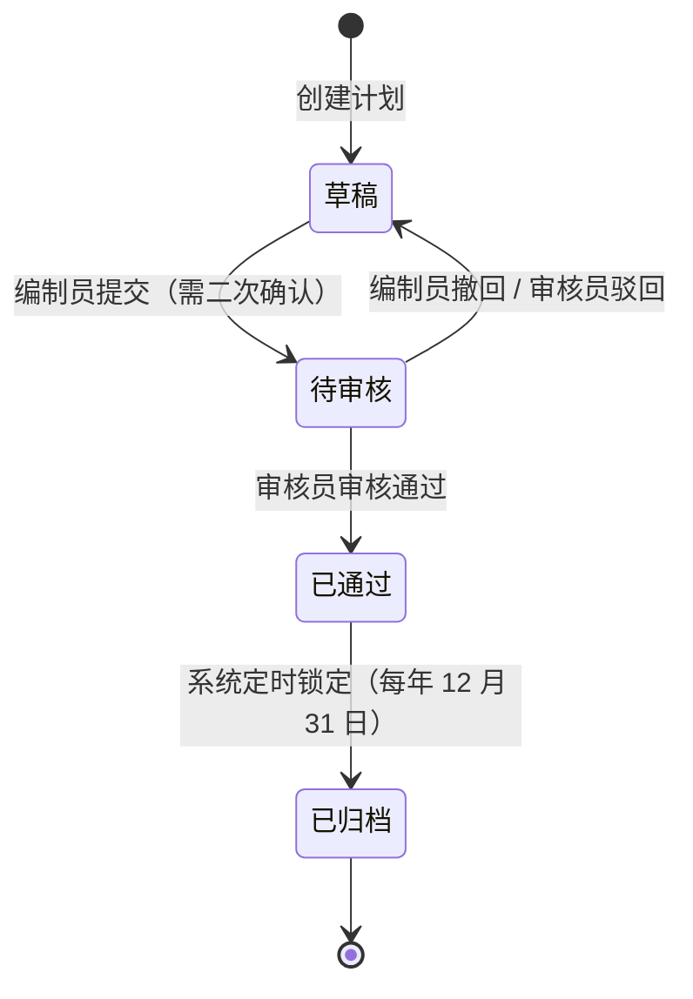

# PRD 编写规则（B 端系统 · 强制清单版）

> **适用范围**：面向 React + Java 技术栈的 B 端企业系统产品需求文档。
> **使用方式**：本规则为强制清单，PRD 提交前逐项自检；**任一"必须项"缺失直接打回，不进入评审环节**。
> **版本**：v1.1

---

## 1. 需求基本信息

### 编写要求

文档开头必须有一张元信息表，所有字段必填，不得模糊填写：

| 字段 | 格式要求 | 不接受的填法 |
|------|---------|------------|
| 需求名称 | 动词 + 对象，不超过 20 字 | "优化计划模块" |
| 需求编号 | PRD-YYYYMM-NNN | "计划-001" |
| 需求优先级 | P0 / P1 / P2，括号内说明理由 | "重要"、"紧急" |
| 提出人 / 产品负责人 | 全名 + 钉钉/飞书账号 | 仅写姓名 |
| 预计上线时间 | 精确到周，如 2026-W22 | "尽快"、"Q2" |
| 关联需求 | 前置 / 后置 / 依赖的 PRD 编号，无则填"无" | 空白不填 |
| 涉及端 | Web / 移动 / 后端 / 对接外部系统（逐一列出） | "前后端" |
| 影响范围 | 新增模块 or 改造已有模块（写出模块名） | "全站" |

### 示例

```
需求名称    多级计划协同编制-审核流程
需求编号    PRD-202604-015
需求优先级  P0（阻塞 2026-Q2 上线里程碑）
产品负责人  张三 / DingTalk: zhang.san
预计上线    2026-W22
关联需求    依赖 PRD-202603-008（组织层级管理），被 PRD-202605-002（统计报表）依赖
涉及端      Web 前端 + Java 后端 + 对接 OA 审批系统
影响范围    改造"计划编制"模块，新增"审核中心"模块
```

---

## 2. 范围定义

### 编写要求

**2.1 本次做什么（包含项）**

用编号列表列出本次交付的功能点，每条必须满足：
- 格式：`含-XX  [角色] 能够/系统支持 [动作] [对象]`
- 单条不超过 30 字，可独立验收

**2.2 本次不做什么（排除项）**

必须明确列出被讨论过但本期不做的功能。**至少 3 条，否则视为范围未收敛。**
- 格式：`排-XX  不支持/不做 [功能]（原因或规划期次）`

**2.3 边界说明**

对可能产生歧义的边界场景，用"场景 / 立场"格式逐条明确，每条给出确定性结论，不得含糊。

### 示例

**包含项**
```
含-01  规划编制员能够在计划列表页批量导出选中计划为 Excel
含-02  系统支持按省 / 市 / 县三级行政区划过滤计划列表
含-03  管理员能够撤回已提交但未审核的计划并退回草稿状态
含-04  规划审核员能够在审核时填写驳回原因并退回给编制员
```

**排除项**
```
排-01  不支持计划的跨年度迁移（列入下期规划）
排-02  不支持自定义导出字段（固定导出 15 列标准字段）
排-03  不做 Excel 导入校验失败后的在线修改（用户需下载修正后重传）
排-04  不对接省级 ERP 系统（ERP 接口文档尚未提供，另起需求跟进）
```

**边界说明**
```
场景  已归档的计划，编制员是否还能查看详情？
立场  可以查看，但所有编辑入口隐藏，仅展示只读详情页。

场景  审核员驳回计划时，驳回原因是否必填？
立场  必填，后端校验，为空时拒绝请求并返回错误提示。

场景  编制员能否查看其他地市的计划？
立场  不能。列表接口按当前用户所属组织过滤，前端无跨组织入口。
```

---

## 3. 用户角色与权限矩阵

### 编写要求

**3.1 角色定义**

列出本次需求涉及的所有角色，每个角色说明：角色名称、所属组织层级、核心职责。

**3.2 权限矩阵**

以功能点为行、角色为列，交叉填写权限，要求覆盖本次所有"包含项"功能点，不得遗漏。

符号约定：✅ 允许 ／ ❌ 禁止 ／ ⚠️ 有条件允许（必须在矩阵下方写明具体条件）

### 示例

**角色定义**

| 角色名称 | 所属层级 | 核心职责 |
|---------|---------|---------|
| 规划编制员 | 地市级 | 编制、维护本地市年度规划计划 |
| 规划审核员 | 省级 | 审核下级地市上报的规划计划 |
| 系统管理员 | 全局 | 处理异常数据、撤回、权限配置 |

**权限矩阵**

| 功能点 | 规划编制员 | 规划审核员 | 系统管理员 |
|-------|:---:|:---:|:---:|
| 查看本组织计划列表 | ✅ | ✅ | ✅ |
| 查看下级组织计划列表 | ❌ | ✅ | ✅ |
| 创建计划 | ✅ | ❌ | ✅ |
| 编辑草稿计划 | ✅ | ❌ | ✅ |
| 提交计划审核 | ✅ | ❌ | ✅ |
| 撤回待审核计划 | ⚠️ | ❌ | ✅ |
| 审核通过 | ❌ | ✅ | ✅ |
| 审核驳回 | ❌ | ✅ | ✅ |
| 删除草稿计划 | ⚠️ | ❌ | ✅ |
| 导出计划 Excel | ✅ | ✅ | ✅ |

**条件说明（⚠️）**
- 撤回待审核计划（规划编制员）：仅限撤回自己创建的计划，且审核员尚未开始审核操作
- 删除草稿计划（规划编制员）：仅限删除自己创建的计划

---

## 4. 交互与状态

### 编写要求

**4.1 页面清单**

列出所有新增或改造的页面，给出唯一页面编号、页面名称，标明新增或改造、进入入口。页面编号在文档其他章节统一引用，便于跨章节定位。

**4.2 交互原型**

每个页面必须提供 Figma / 蓝湖 / Axure 原型链接，或标注了交互说明的高保真截图。原型必须覆盖：所有按钮的点击行为和跳转目标、所有表单字段的默认值和提示文案、加载态 / 空态 / 禁用态、分页 / 筛选 / 排序的交互细节。

**纯文字描述不予接受。**

原型图必须对关键元素进行编号标注（如 ①②③），§4.4 关键交互细节和 §7 接口清单中引用对应编号，确保图文一一对应，避免文字描述与原型脱节。

**4.3 状态流转图**

凡是业务对象有多个状态，必须提供状态机图（Mermaid 或截图均可）。图之后附状态说明表，逐状态说明：含义、可执行操作（含操作角色）、可见范围。每个状态转换必须说明触发条件、操作角色、是否需要二次确认弹窗。

**4.4 关键交互细节**

以下场景必须由产品明确给出决策，不得留给研发自行决定：

| 场景类型 | 必须回答的问题 |
|---------|-------------|
| 表单提交后 | 停留原页 / 跳转到哪个页面 / 弹出什么提示 |
| 删除 / 危险操作 | 是否有二次确认弹窗？弹窗标题和正文文案是什么？ |
| 安全操作 / 防误 | 涉及指令下发、状态变更等高风险操作，是否需要密码二次验证、双人监护或操作锁？验证失败后的处理是什么？ |
| 批量操作 | 支持最大条数？超出上限如何处理？ |
| 列表加载 | 分页 or 滚动加载？每页多少条？是否可配置？ |
| 搜索 | 即时搜索 or 点击按钮触发？支持哪些字段匹配？ |
| 筛选条件 | 切换页面后是否保留？刷新后是否保留？ |

**4.5 页面事件列表**

以**页面为单位**，每个页面单独一张事件表，列出该页面上所有可能触发动作的事件。前端开发依据此表完成事件绑定，不应有任何触发点需要开发自行猜测。

每张表须覆盖以下所有事件类型：

| 事件类型 | 说明 | 典型例子 |
|---------|------|---------|
| 画面初始化 | 页面加载完成后自动触发 | 自动调用列表查询接口、初始化下拉选项 |
| 用户点击 | 按钮、链接、行操作等主动点击 | 点击"提交"、点击列表行展开详情 |
| 值变化 | 下拉框选中、复选框勾选、开关切换 | 选择省后级联加载市列表 |
| 焦点丢失 | 输入框失焦后触发 | 输入计划名称后离开，触发名称查重 |
| 定时触发 | 系统按时间间隔自动触发 | 每 10 秒轮询导出任务状态 |
| 滚动触底 | 列表滚动到底部触发 | 加载下一页数据（无限滚动模式） |

每条事件必须填写：

| 列名 | 说明 |
|------|------|
| 事件编号 | 事-页面编号-序号，如 事-01-01 |
| 触发时机 | 用上表事件类型描述 |
| 触发元素 | 哪个按钮 / 字段 / 区域，对应原型图编号 |
| 触发条件 | 无条件 / 特定状态下才触发（如"表单校验通过后"） |
| 动作类型 | 调用接口 / 前端行为 / 页面跳转 |
| 关联接口或行为描述 | 调用接口填接口编号；前端行为用一句话描述 |

**不需要填写**：接口的具体参数（那在 §7 里定义）；此表只建立"触发点 → 动作"的映射。

**4.6 UI 状态规则**

以**页面为单位**，每个页面单独一张状态规则表，集中定义该页面关键元素在不同条件下的显示状态。前端开发依据此表完成条件渲染和禁用逻辑，不应有任何显隐规则需要开发自行推断。

**哪些元素需要定义**：按钮、操作列、表单字段、页面区域——凡是存在"在某些条件下不显示"或"在某些条件下禁用/只读"的元素，都必须在此列出。始终可见且始终可操作的元素不需要列出。

每条规则必须填写：

| 列名 | 说明 |
|------|------|
| 元素名称 | 与原型图编号对应，如"③列表行'编辑'按钮" |
| 状态类型 | 显示/隐藏 / 启用/禁用 / 可编辑/只读 |
| 条件来源 | 角色权限 / 业务对象状态 / 接口返回字段 / 用户操作上下文 |
| 触发条件 | 用业务语言描述，精确到具体值 |
| 状态结果 | 满足条件时元素的状态 |
| 备注 | 有多个条件时说明 AND / OR 关系 |

**条件来源优先级原则**：能从接口返回字段读取的（如"可编辑"标识字段），直接用字段值控制，不在前端重复计算角色和状态；需要前端自行判断的（如用户操作上下文），明确说明判断依据。

### 示例

**页面清单**

| 页面编号 | 页面名称 | 新增/改造 | 入口 |
|---------|---------|----------|------|
| 页-01 | 计划列表页 | 改造 | 顶部菜单"计划管理" |
| 页-02 | 计划编辑页 | 新增 | 页-01 列表行"编辑"按钮、页-01 顶部"新建"按钮 |
| 页-03 | 审核详情页 | 新增 | 站内消息通知链接、页-01 列表行"审核"按钮 |

**交互原型**
- 页-01 计划列表页：[原型页面链接](https://figma.com/xxx)（含筛选、批量操作、状态标签交互标注）
- 页-02 计划编辑页：[原型页面链接](https://figma.com/yyy)（含表单校验态、提交确认弹窗标注）
- 页-03 审核详情页：[原型页面链接](https://figma.com/zzz)（含通过/驳回操作流、驳回原因输入标注）

**状态流转图**



**状态说明表**

| 状态 | 含义 | 可执行操作（操作角色） | 可见范围 |
|------|------|-------------------|---------|
| 草稿 | 编制中，未提交 | 编辑、提交（编制员）；删除（编制员/管理员） | 创建者 + 管理员 |
| 待审核 | 已提交，等待上级审核 | 撤回（编制员）；通过、驳回（审核员） | 创建者 + 审核员 + 管理员 |
| 已通过 | 审核通过，不可再修改 | 无（管理员可在后台异常撤回） | 全员只读 |
| 已归档 | 年末系统自动锁定 | 无 | 全员只读 |

**关键交互细节**

| 场景 | 产品决策 |
|------|---------|
| 编制员提交计划 | 弹出确认弹窗（标题："确认提交审核？"；正文："提交后将无法编辑，确认提交给上级审核。"；按钮："取消 / 确认提交"）。点击确认后停留当前页，状态标签实时更新为"待审核"，顶部 顶部提示文案 提示"提交成功" |
| 审核员驳回计划 | 弹出驳回原因输入框（必填，最长 200 字）。确认后跳转回审核列表页，顶部提示文案 提示"已驳回，已通知编制员" |
| 批量导出上限 | 最多 1000 条；超出时阻止导出，弹窗提示"单次最多导出 1000 条，请缩小筛选范围后重试" |
| 列表筛选条件持久化 | 切换到编辑页再返回时保留；手动刷新浏览器后重置 |

**页面事件列表与 UI 状态规则（以下按页面为单位各出一组）**

**页-01 计划列表页**

事件列表

| 事件编号 | 触发时机 | 触发元素 | 触发条件 | 动作类型 | 关联接口或行为 |
|---------|---------|---------|---------|---------|-------------|
| 事-01-01 | 画面初始化 | — | 无条件 | 调用接口 | 接-01 查询计划列表 |
| 事-01-02 | 值变化 | ①筛选区"规划年度"下拉框 | 值发生变化 | 调用接口 | 接-01（重新查询，页码重置为 1） |
| 事-01-03 | 值变化 | ①筛选区"计划类型"下拉框 | 值发生变化 | 调用接口 | 接-01（重新查询，页码重置为 1） |
| 事-01-04 | 用户点击 | ①筛选区"搜索"按钮 | 无条件 | 调用接口 | 接-01（重新查询，页码重置为 1） |
| 事-01-05 | 用户点击 | ②操作区"新建"按钮 | 无条件 | 页面跳转 | 跳转至计划新建页（页-02） |
| 事-01-06 | 用户点击 | ③列表行"编辑"按钮 | 当前用户对该计划有编辑权限 | 页面跳转 | 跳转至该计划的编辑页（页-02） |
| 事-01-07 | 用户点击 | ③列表行"删除"按钮 | 当前用户对该计划有删除权限 | 前端行为 | 弹出二次确认弹窗（见 §4.4） |
| 事-01-08 | 用户点击 | 二次确认弹窗"确认删除" | — | 调用接口 | 接-04 删除计划，成功后刷新列表 |
| 事-01-09 | 用户点击 | ②操作区"导出"按钮 | 至少勾选 1 条 | 调用接口 | 接-03 异步导出 Excel |
| 事-01-10 | 用户点击 | 分页组件页码 / 上一页 / 下一页 | 无条件 | 调用接口 | 接-01（更新页码） |
| 事-01-11 | 定时触发 | — | 存在"处理中"的导出任务 | 调用接口 | 接-05 查询导出任务状态（每 5 秒一次，完成后停止轮询） |

UI 状态规则

| 元素名称 | 状态类型 | 条件来源 | 触发条件 | 状态结果 | 备注 |
|---------|---------|---------|---------|---------|------|
| ②"新建"按钮 | 显示/隐藏 | 角色权限 | 当前用户角色为"规划编制员"或"系统管理员" | 显示 | 否则隐藏 |
| ②"导出"按钮 | 启用/禁用 | 用户操作上下文 | 列表中已勾选至少 1 条记录 | 启用 | 否则禁用，悬停提示"请至少勾选一条记录" |
| ③列表行"编辑"按钮 | 显示/隐藏 | 接口返回字段 | 列表接口返回当前用户对该计划有编辑权限 | 显示 | 否则隐藏，不占位 |
| ③列表行"删除"按钮 | 显示/隐藏 | 接口返回字段 | 列表接口返回当前用户对该计划有删除权限 | 显示 | 否则隐藏，不占位 |
| ③列表行"审核"按钮 | 显示/隐藏 | 接口返回字段 + 业务对象状态 | 列表接口返回当前用户有审核权限，且计划状态为"待审核" | 显示 | 否则隐藏 |
| 列表行状态标签颜色 | 样式变化 | 业务对象状态 | 草稿=灰色；待审核=橙色；已通过=绿色；已归档=蓝色 | 对应颜色 | 颜色值见设计规范 |

**页-02 计划编辑页**

事件列表

| 事件编号 | 触发时机 | 触发元素 | 触发条件 | 动作类型 | 关联接口或行为 |
|---------|---------|---------|---------|---------|-------------|
| 事-02-01 | 画面初始化 | — | 当前为编辑模式（打开已有计划） | 调用接口 | 接-06 查询计划详情，结果回填表单 |
| 事-02-02 | 画面初始化 | — | 当前为新建模式（从新建入口进入） | 前端行为 | 表单各字段展示默认值，不调接口 |
| 事-02-03 | 焦点丢失 | "计划名称"输入框 | 内容非空且与初始值不同 | 调用接口 | 接-07 名称查重（后端校验），返回重复时输入框下方展示错误提示 |
| 事-02-04 | 值变化 | "计划类型"下拉框 | 值发生变化 | 前端行为 | 重置"计划说明"字段为空（不同类型说明模板不同） |
| 事-02-05 | 用户点击 | "保存草稿"按钮 | 无条件 | 调用接口 | 接-08 保存计划，成功后 顶部提示文案 提示"保存成功" |
| 事-02-06 | 用户点击 | "提交审核"按钮 | 表单整体校验通过 | 前端行为 | 弹出二次确认弹窗（见 §4.4） |
| 事-02-07 | 用户点击 | 二次确认弹窗"确认提交" | — | 调用接口 | 接-02 提交计划审核 |
| 事-02-08 | 用户点击 | "取消"按钮 | 表单有未保存修改 | 前端行为 | 弹出"有未保存的内容，确认离开？"确认弹窗 |
| 事-02-09 | 用户点击 | "取消"按钮 | 表单无未保存修改 | 页面跳转 | 返回计划列表页（页-01） |

UI 状态规则

| 元素名称 | 状态类型 | 条件来源 | 触发条件 | 状态结果 | 备注 |
|---------|---------|---------|---------|---------|------|
| 所有表单字段 | 可编辑/只读 | 业务对象状态 | 计划状态为"草稿" | 可编辑 | 其他状态全部只读 |
| "计划类型"字段 | 可编辑/只读 | 用户操作上下文 | 新建模式（当前计划尚未创建） | 可编辑 | 编辑模式下始终只读（创建后不允许修改） |
| "保存草稿"按钮 | 显示/隐藏 | 业务对象状态 | 计划状态为"草稿" | 显示 | 其他状态隐藏 |
| "提交审核"按钮 | 显示/隐藏 | 业务对象状态 | 计划状态为"草稿" | 显示 | 其他状态隐藏 |
| "提交审核"按钮 | 启用/禁用 | 用户操作上下文 | 表单整体校验通过（无红色报错） | 启用 | 否则禁用 |
| "撤回"按钮 | 显示/隐藏 | 接口返回字段 | 详情接口返回当前用户有撤回权限 | 显示 | 否则隐藏 |
| "驳回原因"展示区 | 显示/隐藏 | 业务对象状态 | 计划状态为"草稿" AND 存在最近一次驳回记录 | 显示 | 展示最近一条驳回原因，提醒编制员修改方向 |
| "计划名称"查重错误提示 | 显示/隐藏 | 用户操作上下文 | 名称查重接口返回当前计划名称已被占用 | 显示红色错误文案 | 用户修改内容后自动隐藏 |

---

## 5. 异常与边界场景

### 编写要求

**5.1 通用异常清单**

每个页面 / 功能必须回答下表中的所有场景，不得留空。研发不替产品做 UI / 交互决策。

| 场景 | 必须回答的问题 |
|------|-------------|
| 空态 | 列表无数据时显示什么？有无空状态图？引导操作文案是什么？ |
| 加载态 | 骨架屏还是加载动画？超时阈值多少秒？超时后展示什么？ |
| 错误态 | 接口 5xx 时页面如何展示？是否有"重试"按钮？ |
| 权限不足 | 403 时跳转到错误页还是页内提示？提示文案是什么？ |
| 登录失效 | 401 时跳转登录页还是弹窗？登录成功后是否跳回原页面？ |
| 网络异常 | 无网络时的提示文案？是否支持离线操作？ |
| 表单校验 | 实时校验还是提交时校验？错误文案显示在字段下方还是顶部？ |
| 重复提交 | 提交中按钮是否置灰？如何防止重复点击？ |
| 并发冲突 | 两人同时编辑同一条记录如何处理？乐观锁还是悲观锁？冲突提示文案？ |
| 数据过长 | 超长字段如何截断展示？是否有 悬浮提示 显示完整内容？ |
| 历史数据兼容 | 存量数据不满足新校验规则时如何展示？是否需要数据迁移脚本？ |
| 外部依赖失败 | 依赖的外部系统（如 SCADA、OA）接口超时或不可用时，业务流程如何降级？是允许用户手动录入、还是阻断操作并提示？降级入口如何触发？ |

**5.2 业务异常清单**

针对每个主要业务流程，列出所有可能的异常分支。每条必须说明：异常场景、系统行为、前端提示文案。

### 示例

**通用异常（计划列表页 页-01）**

| 场景 | 处理方案 |
|------|---------|
| 空态 | 展示空状态插画 + 文案"暂无计划，点击右上角「新建计划」开始编制"，有新建权限时展示按钮 |
| 加载态 | 骨架屏（3 行占位），超过 10 秒无响应展示"加载超时，请刷新重试"，附刷新按钮 |
| 错误态 | 页面中部展示"数据加载失败"图标 + 文案 + "重试"按钮，点击重新请求接口 |
| 权限不足 | 跳转全局 403 页面，展示"您无权访问该页面，请联系管理员" |
| 登录失效 | 跳转登录页，登录成功后跳回计划列表页 |
| 重复提交 | 提交按钮点击后立即置灰，接口返回后恢复；前端加 300ms 防抖 |
| 并发冲突 | 使用乐观锁（version 字段），冲突时提示"数据已被他人修改，请刷新后重试" |
| 数据过长 | 计划名称超过 20 字时截断并加省略号，鼠标悬停展示完整名称 悬浮提示 |
| 外部依赖失败 | OA 审批系统接口超时（≥ 5s）时，提示"外部系统暂时不可用，您可手动填写审批人工号后继续提交"；手动录入入口自动展示，不阻断主流程 |

**业务异常（计划提交流程）**

| 异常场景 | 系统行为 | 前端提示文案 |
|---------|---------|------------|
| 计划下项目数为 0 | 前端拦截，不调接口 | "至少添加一个项目后才能提交" |
| 必填字段未填写 | 前端拦截，定位到第一个未填字段并高亮 | "请完成所有必填项后再提交" |
| 上级单位申报通道已关闭 | 接口返回业务错误码，前端弹窗提示 | "当前申报已截止（截止日期：XX），如需提交请联系省级管理员" |
| 重复提交（网络重试导致） | 后端幂等处理，返回当前状态，前端展示成功 | "提交成功"（与正常一致） |
| 提交时网络中断 | 接口超时，前端提示错误，按钮恢复可点击 | "网络异常，提交失败，请稍后重试" |
| 审核员已开始审核，编制员尝试撤回 | 接口返回业务错误码 | "审核已进行中，无法撤回，如需处理请联系审核员" |

---

## 6. 数据与字段定义

> **定位说明**：本章描述的是**业务层面**的数据定义——用户在页面上看到什么、填什么、受什么规则约束。不涉及数据库表结构、主键设计、索引策略等实现细节，那些是研发的职责。

### 编写要求

**6.1 用户可见字段**

对每个表单 / 业务实体，逐字段说明用户侧的信息。每行必须包含以下所有列：

| 列名 | 说明 |
|------|------|
| 展示名 | 页面上显示给用户的中文标签 |
| 输入类型 | 文本框 / 数字输入 / 下拉选择 / 日期选择器 / 富文本 / 只读展示 等 |
| 是否必填 | ✅ 必填 / ❌ 选填 |
| 默认值 | 页面打开时的初始值，无则填"—" |
| 校验规则 | 用业务语言描述，如"不超过 50 字"、"只能选未来 5 年内的年份" |
| 枚举取值 | 下拉选项的业务含义列表，其他类型填"—" |
| 占位符 / 提示文案 | 输入框内的占位提示文案或字段旁的说明文案 |
| 备注 | 特殊交互说明，如"创建后不允许修改"、"仅管理员可编辑" |

**不需要填写**：字段英文名、数据类型（String/Integer）、数据库长度限制、系统自动生成的字段（如创建时间、创建人）——这些交给研发在接口设计阶段定义。

**校验规则的前后端分工**：在"校验规则"列中，如果某条规则涉及与服务端数据比对（如名称查重、权限越级校验、状态一致性校验），请在括号内注明"后端校验"；其余格式类、非空类规则默认由前端执行。产品不需要决定实现方式，但需要明确哪些校验依赖服务端数据——研发据此判断是否需要额外接口。

示例写法：
- `不超过 50 字；不允许全为空格` → 前端校验，无需注明
- `同一组织下不允许重复（后端校验）` → 需要查库，注明后端

**6.2 业务规则**

不适合放在字段行内描述的跨字段规则、唯一性约束、数量限制等，在此单独列出。用业务语言描述，不涉及实现方式。

**6.3 枚举取值字典**

所有下拉选项在此集中定义，给出每个选项的展示文案和业务含义说明。**只写用户看到的中文选项，不写技术编码（如 DRAFT、PENDING）——技术编码由研发在接口设计阶段定义。**

**6.4 业务对象关系**

说明业务对象之间的组成关系和约束，用业务语言描述。重点说明：一个对象下包含哪些子对象、删除 / 修改时有哪些业务限制。

凡是在页面上展示给用户的关联对象（即使用户不填写任何内容），也必须给出其**展示字段定义表**，说明展示哪些字段、展示格式、可见范围。字段定义表分两种：

| 对象类型 | 表格格式 |
|---------|---------|
| 用户可填写的对象（如表单、子记录） | 使用 §6.1 的字段定义格式（含输入类型、必填、校验规则等） |
| 系统自动生成、用户只读的对象（如日志、审批记录） | 使用只读展示格式（展示名、展示类型、说明、可见范围） |

### 示例

**用户可见字段（计划编辑表单）**

| 展示名 | 输入类型 | 必填 | 默认值 | 校验规则 | 枚举取值 | 占位符 / 提示文案 | 备注 |
|-------|---------|:---:|-------|---------|---------|----------------|------|
| 计划名称 | 文本框 | ✅ | — | 不超过 50 字；不允许全为空格 | — | 请输入计划名称 | — |
| 规划年度 | 年份选择器 | ✅ | 当前年份 | 只能选当前年及未来 4 年（共 5 个选项） | — | — | — |
| 计划类型 | 下拉单选 | ✅ | 年度计划 | 必须从列表中选择 | 见枚举字典 | 请选择计划类型 | 创建后不允许修改 |
| 计划说明 | 富文本编辑器 | ❌ | — | 不超过 500 字（纯文本计数，不含格式标签） | — | 可填写计划背景、目标等补充说明 | — |
| 状态 | 只读标签 | — | 草稿 | — | 见枚举字典 | — | 系统根据流程自动变更，用户不可手动修改；见 §4.3 状态机 |

**业务规则**

```
规-01  同一组织下，计划名称不允许重复（重复时提示"该名称已存在，请更换"）
规-02  计划类型一旦保存，不允许修改
规-03  一个计划下最多包含 200 个计划项目
规-04  规划年度只能选择当前年及未来 4 年，不允许选历史年份
规-05  草稿状态的计划，30 天未编辑后系统发送提醒通知（不自动删除）
```

**枚举取值字典**

```
计划类型
  年度计划   —  对应完整自然年的建设计划
  季度计划   —  对应某一季度的建设计划
  月度计划   —  对应某一月份的建设计划

计划状态
  草稿       —  编制中，尚未提交，仅创建者可见
  待审核     —  已提交，等待上级审核员处理
  已通过     —  审核通过，内容锁定不可修改
  已归档     —  年末系统自动锁定，进入历史归档
```

**业务对象关系**

```
计划（Plan）包含多个计划项目（PlanItem）
  - 一个计划可以有 1 到 200 个计划项目
  - 提交审核前，至少需要添加 1 个计划项目
  - 计划处于"草稿"状态时，可以自由增删计划项目
  - 计划提交审核后，计划项目随之锁定，不允许再增删改

计划（Plan）产生审批记录（ApprovalRecord）
  - 每次提交、审核通过、审核驳回，系统自动生成一条审批记录
  - 审批记录只读，用户不可编辑或删除
  - 删除计划草稿时，审批记录一并删除（草稿阶段尚无审批记录）
```

**子对象字段定义（计划项目 PlanItem）**

| 展示名 | 输入类型 | 必填 | 默认值 | 校验规则 | 枚举取值 | 占位符 / 提示文案 | 备注 |
|-------|---------|:---:|-------|---------|---------|----------------|------|
| 项目名称 | 文本框 | ✅ | — | 不超过 100 字；不允许全为空格 | — | 请输入项目名称 | 同一计划下项目名称不允许重复 |
| 项目类型 | 下拉单选 | ✅ | — | 必须从列表中选择 | 见枚举字典 | 请选择项目类型 | — |
| 计划投资额 | 数字输入 | ✅ | — | 大于 0，不超过 99999999，最多保留 2 位小数 | — | 单位：万元 | — |
| 建设起止年份 | 年份范围选择器 | ✅ | — | 开始年份 ≤ 结束年份；结束年份不得早于所属计划的规划年度 | — | — | — |
| 项目说明 | 文本框 | ❌ | — | 不超过 200 字 | — | 可填写项目背景或特殊说明 | — |

**关联对象展示字段定义（审批记录 ApprovalRecord）**

> 审批记录由系统自动生成，用户不填写任何内容，但在计划详情页的"审批历史"面板中可见。以下为展示字段定义。

| 展示名 | 展示类型 | 说明 | 可见范围 |
|-------|---------|------|---------|
| 操作人 | 只读文本 | 展示姓名，如"张三" | 创建者 + 审核员 + 管理员 |
| 操作时间 | 只读文本 | 格式：yyyy-MM-dd HH:mm | 同上 |
| 操作类型 | 只读标签 | 见下方枚举字典"审批操作类型" | 同上 |
| 备注 | 只读文本 | 提交备注或驳回原因；无内容时展示"—" | 同上 |

审批记录枚举字典补充：

```
审批操作类型
  提交审核   —  编制员将计划提交给上级
  审核通过   —  审核员确认计划通过
  审核驳回   —  审核员驳回计划并退回草稿
  撤回       —  编制员在审核前主动撤回
```

**父子对象联动业务规则**

```
子规-01  删除计划项目时，若所属计划状态不是"草稿"，禁止删除，提示"计划已提交，不允许修改项目"
子规-02  计划项目的建设起止年份不得早于所属计划的规划年度
子规-03  同一计划下，项目名称不允许重复（重复时提示"该项目名称已存在，请更换"）
子规-04  删除最后一个计划项目时弹窗警告："删除后计划将无法提交审核，确认删除？"
```

---

## 7. 接口清单

### 编写要求

产品不负责写接口设计，但必须说清楚：数据从哪来、传什么进去、期望拿什么回来、后台要做什么事。研发凭此评估工作量、识别风险，缺项直接打回。

**7.1 接口总览表**

列出所有接口的全局索引，每条包含：接口编号、接口用途、关联页面、触发时机、新增或改造、数据量级、特殊约束。

**7.2 接口详情**

每条接口必须单独描述，包含以下四部分：

- **触发场景**：什么用户、在什么页面、什么操作时机调用
- **Input**：每个参数的名称、类型、是否必传、**来源**（筛选控件 / 登录上下文 / 页面跳转携带 / 用户输入）、取值说明
- **Output**：每个字段的名称、类型、含义、**用于页面哪个位置**
- **后台处理逻辑**：前置校验规则（逐条）、业务处理步骤（含事务边界）、幂等 / 并发控制方案、异常降级策略

> **关于字段名和类型的写法**：产品同学使用**业务中文名 + 业务类型**描述即可，**不要求**给出英文字段名（如 `planYear`）或具体技术类型（如 `String / Integer / Boolean / Enum`）——这些英文标识符和数据库 / SQL 细节由研发在接口设计阶段决定。
>
> - **参数名 / 字段名**：写业务中文名，例如"规划年度"、"计划名称"、"是否可编辑"，而不是 `planYear`、`planName`、`canEdit`
> - **类型**：使用业务语义类型，例如"数字 / 文本 / 布尔（是/否）/ 单选枚举 / 多选枚举 / 日期 / 日期时间 / 列表 / 对象"
> - **后台处理逻辑**：用业务语言描述系统应做什么，不写 SQL、表名、字段名等技术细节（如不写 `org_id = ?`、`status = DRAFT`、`SELECT FOR UPDATE` 等）
>
> **唯一硬性要求是逻辑自洽**：同一个字段在 Input、Output、后台处理逻辑、§5 异常清单、§6 字段定义、§8 验收标准中必须使用**完全相同的中文名称**，不能在不同位置出现"规划年度 / 年度 / 计划年度"这种混用。如果发现同一概念有多个叫法，统一到 §6 字段定义中的展示名。

**7.3 外部系统对接**

涉及对接外部系统时，必须额外提供：系统名称与联系人、对接文档链接、数据方向、字段映射表、失败降级方案、SLA 要求、联调排期。

**7.4 接口完整性自检**

- [ ] §4 中每个页面的数据请求在本节都有对应 API 编号
- [ ] 每个 Input 字段都标注了数据来源
- [ ] 每个 Output 字段都说明了页面用途，无"顺便返回"的字段
- [ ] 后台逻辑中的业务规则在 §5 / §6 均有对应说明
- [ ] 有外部系统对接的已填写 §7.3
- [ ] **字段命名逻辑自洽**：同一字段在 Input、Output、后台逻辑、§4 / §5 / §6 / §8 中使用相同的中文名称，无"规划年度 / 年度 / 计划年度"这类混用

### 示例

**接口总览表**

| 接口编号 | 接口用途 | 关联页面 | 触发时机 | 新增/改造 | 数据量级 | 特殊约束 |
|---------|---------|---------|---------|---------|---------|---------|
| 接-01 | 查询计划列表 | 页-01 | 页面加载、筛选变化、翻页 | 新增 | ≤ 500 条/次 | 按组织层级过滤数据 |
| 接-02 | 提交计划审核 | 页-02 | 点击"提交审核"并二次确认 | 新增 | — | 需幂等、需事务 |
| 接-03 | 异步导出计划 Excel | 页-01 | 点击"导出"按钮 | 新增 | ≤ 10000 行 | 异步任务，结果推送下载中心 |

---

**接-01 查询计划列表**

触发场景：用户进入 页-01 时自动调用；修改任意筛选条件或切换分页时重新调用。

Input

| 参数 | 类型 | 必传 | 来源 | 说明 |
|-----|------|:---:|------|------|
| 规划年度 | 数字 | 否 | 筛选控件"规划年度" | 不传则不按年度过滤 |
| 计划类型 | 单选枚举 | 否 | 筛选控件"计划类型" | 取值参见 §6.3 计划类型枚举字典；不传则不过滤 |
| 状态 | 多选枚举 | 否 | 筛选控件"状态"（多选） | 取值参见 §6.3 计划状态枚举字典；不传则不过滤 |
| 关键词 | 文本 | 否 | 搜索框输入 | 模糊匹配"计划名称"；去首尾空格；最长 50 字 |
| 当前组织 | 文本 | 是 | 登录上下文自动带入 | 当前用户所属组织标识；前端不展示此字段 |
| 页码 | 数字 | 是 | 分页组件 | 从 1 开始 |
| 每页条数 | 数字 | 是 | 分页组件 | 固定 20，前端不允许修改 |

Output

| 字段 | 类型 | 说明 | 用于页面哪里 |
|-----|------|------|------------|
| 总条数 | 数字 | 符合条件的总条数 | 分页组件显示"共 XX 条" |
| 计划列表 → 计划 ID | 文本 | 计划唯一标识 | 列表行操作按钮跳转计划编辑页（页-02）/ 审核详情页（页-03）时携带 |
| 计划列表 → 计划名称 | 文本 | 计划名称 | 列表第一列，超 20 字截断加 悬浮提示 |
| 计划列表 → 规划年度 | 数字 | 规划年度 | 列表第二列 |
| 计划列表 → 计划类型 | 单选枚举 | 计划类型 | 列表第三列，按 §6.3 枚举字典展示中文 |
| 计划列表 → 当前状态 | 单选枚举 | 当前流转状态 | 列表状态列，按状态映射不同颜色标签 |
| 计划列表 → 最后修改时间 | 日期时间 | 最后一次修改的时间 | 列表时间列，格式 yyyy-MM-dd HH:mm |
| 计划列表 → 是否可编辑 | 布尔 | 当前用户对该条计划是否有编辑权限 | 控制"编辑"按钮显隐，为"是"才展示 |
| 计划列表 → 是否可删除 | 布尔 | 当前用户对该条计划是否有删除权限 | 控制"删除"按钮显隐，为"是"才展示 |

> ⚠️ "是否可编辑 / 是否可删除"由后端根据角色 + 数据状态计算返回，前端不做权限判断，仅按返回值控制按钮显隐。

后台处理逻辑

1. **数据范围过滤**（根据登录用户角色决定可查范围）
   - 规划编制员：仅查询本组织下的计划
   - 规划审核员：查询本组织及其所有下级组织的计划
   - 系统管理员：不限制组织，可查全库

2. **筛选逻辑**：所有传入筛选参数为"且"关系叠加；"关键词"对"计划名称"做模糊匹配

3. **排序规则**：固定按"最后修改时间"倒序排列，不开放前端自定义排序

4. **权限字段计算**（"是否可编辑 / 是否可删除"由后端按以下规则计算后返回）
   - 是否可编辑 = 是：计划状态为"草稿"，且（创建人为当前用户 或 当前用户为系统管理员）
   - 是否可删除 = 是：满足"是否可编辑"全部条件，且该计划尚未生成任何审批流转记录

5. **性能要求**：列表查询 P95 ≤ 500ms；查询字段索引由研发自行设计；组织子节点列表缓存有效期 5 分钟

---

**接-02 提交计划审核**

触发场景：用户在 页-02 点击"提交审核"按钮，二次确认弹窗点击"确认提交"后调用。

Input

| 参数 | 类型 | 必传 | 来源 | 说明 |
|-----|------|:---:|------|------|
| 计划 ID | 文本 | 是 | 当前编辑页对应的计划标识（由进入页面时携带） | 标识本次提交的计划 |
| 提交备注 | 文本 | 否 | 表单"提交备注"输入框 | 最长 200 字；为空时不传 |

Output

| 字段 | 类型 | 说明 | 用于页面哪里 |
|-----|------|------|------------|
| 新状态 | 单选枚举 | 提交后计划的新状态（应为"待审核"） | 前端直接更新状态标签，无需重新拉取列表 |
| 审批流标识 | 文本 | 系统生成的本次审批流转记录的标识 | 预留字段，本期暂不使用；为后续"查看审批进度"功能准备 |

后台处理逻辑

1. **前置校验**（任一失败返回对应业务错误码，终止后续步骤）
   - 计划存在，且所属组织在当前用户的可访问范围内
   - 计划当前状态为"草稿"（防重复提交）
   - 当前用户角色为"规划编制员"或"系统管理员"
   - 该计划下"计划项目"数量 ≥ 1
   - 该计划所有必填字段（见 §6.1）均不为空
   - 上级组织的"申报通道"处于开启状态

2. **业务处理**（须在单一事务中完成，任一步骤异常则全部回滚）
   - 将计划状态由"草稿"流转为"待审核"
   - 更新该计划的版本号（用于后续乐观锁并发控制）
   - 记录一条审批流水：操作人、操作时间、由"草稿"到"待审核"、提交备注
   - 查询上级组织的"规划审核员"用户列表，作为本次审批的指派对象
   - 生成一条审批流转记录，状态置为"待处理"

3. **异步通知**（事务提交后异步执行，失败不影响主流程）
   - 向所有指派的审核员推送站内消息："[计划名称] 已提交审核，请查看"

4. **幂等保证**：以"计划 ID"为幂等键；若计划状态已为"待审核"，直接返回当前状态，不重复生成审批流转记录

5. **并发控制**：处理过程中需对该计划记录加锁，防止两人并发提交

---

**接-03 异步导出计划 Excel**

触发场景：用户在 页-01 勾选计划后点击"导出"按钮，前端校验通过后调用。

Input

| 参数 | 类型 | 必传 | 来源 | 说明 |
|-----|------|:---:|------|------|
| 计划 ID 列表 | 列表 | 与"是否全选筛选结果"二选一 | 列表勾选行 | 指定 ID 导出；最多 1000 条；超出前端拦截不调接口 |
| 是否全选筛选结果 | 布尔 | 与"计划 ID 列表"二选一 | "全选本次筛选结果"复选框 | 为"是"时按当前筛选条件导出全量 |
| 筛选条件快照 | 对象 | "是否全选筛选结果"为"是"时必传 | 当前筛选控件状态快照 | 结构同 接-01 Input（除分页参数外），后端按此重新查询 |

Output（同步响应，非文件本身）

| 字段 | 类型 | 说明 | 用于页面哪里 |
|-----|------|------|------------|
| 导出任务标识 | 文本 | 异步任务的唯一标识 | 前端展示 顶部提示文案："导出任务已提交，请在下载中心查看"；任务标识本期暂不展示给用户 |

后台处理逻辑

1. **同步校验**（校验通过后立即返回，不等待文件生成）
   - 当前用户有导出权限
   - 指定 ID 模式：数量 ≤ 1000；全选筛选模式：按筛选条件查询的总量 ≤ 10000，超出则返回业务错误
   - 创建一条状态为"处理中"的导出任务记录，同步返回任务标识

2. **异步处理**（消息队列消费）
   - 分批查询目标计划数据（每批 500 条，避免大数据量内存压力）
   - 按 §6.1 字段清单的 15 个标准字段组装 Excel，枚举值展示中文
   - 上传文件至文件存储服务，生成下载链接（有效期 24 小时）
   - 将导出任务状态更新为"已完成"，并写入下载链接
   - 向操作人推送站内消息："您的计划导出已完成，点击下载（有效期 24 小时）"

3. **失败处理**：任务异常时状态置为"失败"；下载中心展示"导出失败，请重试"；保留错误信息供排查

---

**外部系统对接（OA 审批系统）**

| 项目 | 内容 |
|------|------|
| 外部系统 | XX 省政务 OA 审批系统，对接负责人：李四（OA 平台组，lisi@oa.gov.cn） |
| 对接文档 | [OA 审批 API 文档 v2.3](http://internal.wiki/oa-api) |
| 数据方向 | 我方调用 OA（计划审核通过后，异步推送归档通知到 OA） |
| 触发时机 | 计划审批结果变为"通过"时，后端异步调用 OA 推送接口 |
| 字段映射 | 计划 ID → OA 业务单据号；计划名称 → OA 标题；所属组织 → OA 部门编码（具体英文字段名由研发与 OA 组对齐） |
| 失败处理 | OA 接口不可用时写入重试队列，最多重试 3 次（间隔 1/5/15 分钟）；3 次失败后触发告警，不阻断主流程 |
| SLA | OA 接口响应 ≤ 3s，可用性 ≥ 99.5% |
| 联调排期 | 预计 2026-W20 联调，需 OA 组提前准备测试环境账号 |

---

## 8. 验收标准

### 编写要求

**8.1 功能验收标准**

每个"包含项"功能点至少写 3 条验收标准，覆盖正常场景、边界场景、异常场景。使用"前提-操作-期望结果"三段式格式：

```
验-XX  [场景名称]
  前提      [前置条件：用户状态、数据状态、权限状态]
  操作      [用户的具体操作]
  期望结果  [可观测的系统行为，精确到界面变化 / 接口状态 / 数据变更]
```

**禁止使用的验收描述**："功能正常可用"、"展示正确"、"操作成功"。"期望结果"必须是可测量、可观察的事实。

**8.2 非功能验收标准**

性能、兼容性、分辨率等非功能指标必须有具体数值和验收方式，不得写"性能良好"。

### 示例

**功能验收标准（对应 含-01 批量导出计划）**

```
验-01  正常导出指定记录
  前提      用户已登录（角色为"规划编制员"），列表中存在 5 条状态为"已通过"的计划
  操作      勾选其中 3 条，点击"导出"按钮
  期望结果  页面顶部出现提示文案："导出任务已提交，请在下载中心查看"
            下载中心出现一条"处理中"的导出记录
            约 30 秒内记录状态变为"完成"，可点击下载
            下载的 Excel 文件名格式为"计划导出_20260421_143000.xlsx"
            文件包含 3 行数据，每行含 §6.1 定义的 15 个标准字段，枚举值展示中文

验-02  未选择记录时导出按钮状态
  前提      用户已登录，列表未勾选任何记录
  操作      查看"导出"按钮
  期望结果  按钮处于禁用状态（灰色，不可点击）
            鼠标悬停时出现悬浮提示："请至少勾选一条记录"

验-03  勾选超过导出上限
  前提      用户已登录，列表已勾选 1001 条记录
  操作      点击"导出"按钮
  期望结果  前端弹出提示弹窗："单次最多导出 1000 条，当前已选 1001 条，请缩小范围后重试"
            不调用导出接口，不创建导出任务

验-04  无导出权限的角色
  前提      用户已登录，但所属角色无导出权限（由管理员配置）
  操作      进入计划列表页
  期望结果  "导出"按钮不展示，页面不出现任何导出入口
```

**非功能验收标准**

| 类别 | 指标 | 目标值 | 验收方式 |
|------|------|-------|---------|
| 性能 | 计划列表首屏加载（500 条数据） | P95 ≤ 2s | Chrome DevTools Performance 面板实测 |
| 性能 | 提交审核接口响应时间 | P95 ≤ 500ms | 后端链路追踪 / 压测报告 |
| 性能 | 10000 行 Excel 异步生成耗时 | ≤ 60s | 测试环境实测 |
| 兼容性 | 浏览器 | Chrome ≥ 100、Edge ≥ 100、360 极速版最新、搜狗最新 | 兼容性测试矩阵（测试执行） |
| 分辨率 | 最低支持 | 1366 × 768，布局不错乱 | UI 走查 |

---

## 9. 非功能性要求

### 编写要求

以下各项，产品必须逐项确认并给出明确回答，不得留空或写"待定"。

**9.1 权限与安全**：新接口是否纳入权限框架、是否涉及数据脱敏、是否需要审计日志、是否需要二次身份验证。

**9.2 审计与日志**：需要留痕的操作必须列出，给出审计内容和留存时长要求。

**9.3 国际化**：是否需要多语言，日期 / 时间 / 数字格式是否有特殊要求。

**9.4 数据埋点**：如需埋点，列出事件名、触发时机、上报字段。如不需要，写"本期不做埋点"。

**9.5 上线策略**：灰度策略、数据迁移方案（含脚本负责人和执行时机）、回滚方案。

### 示例

**权限与安全**

| 问题 | 回答 |
|------|------|
| 新增接口是否纳入现有权限框架？ | 是，所有接口通过 JWT Token 鉴权，走现有 RBAC 权限中心校验 |
| 是否涉及数据脱敏？ | 否，本期无敏感字段（无手机号、身份证、金额类数据） |
| 是否需要审计日志？ | 是，见下方审计日志清单 |
| 是否需要二次身份验证？ | 否 |

**审计日志清单**

| 操作 | 审计内容 | 留存时长 |
|------|---------|---------|
| 提交计划审核 | 操作人、操作时间、计划 ID、提交前的计划完整内容快照 | 3 年 |
| 审核通过 / 驳回 | 操作人、操作时间、计划 ID、操作结果、驳回原因 | 3 年 |
| 删除草稿计划 | 操作人、操作时间、计划 ID、删除前的计划完整内容快照 | 永久 |
| 管理员撤回 | 操作人、操作时间、计划 ID、撤回原因 | 永久 |

**国际化**

| 问题 | 回答 |
|------|------|
| 是否需要多语言支持？ | 否，仅支持简体中文 |
| 日期格式 | 统一 yyyy-MM-dd HH:mm，不区分地区 |

**数据埋点**

> 事件名称用业务中文描述即可，对应的英文埋点 key 由研发与数据团队对齐后落地。

| 事件名称 | 触发时机 | 上报字段 |
|---------|---------|---------|
| 计划列表-导出点击 | 用户点击"导出"按钮（不论是否成功） | 用户 ID、所属组织、勾选条数、当前筛选条件 |
| 计划提交-成功 | 提交审核接口返回成功 | 用户 ID、计划 ID、计划类型 |
| 计划提交-失败 | 提交审核接口返回失败 | 用户 ID、计划 ID、错误码 |

**上线策略**

| 项目 | 方案 |
|------|------|
| 灰度策略 | 先开放 2 个地市白名单，观察 1 周无异常后全量上线 |
| 数据迁移 | 需要。plan 表新增 version 字段，初始值 0；迁移脚本由研发编写，上线前一天维护窗口执行，预计耗时 10 分钟 |
| 回滚方案 | 后端接口版本兼容旧逻辑，前端通过 Feature Flag 控制新功能入口；发现严重 Bug 时关闭 Flag 回退，无需回滚数据库 |

---

## 10. 文档元信息

### 编写要求

**10.1 变更记录**：每次修改文档必须新增一行，说明版本号、日期、变更人、变更内容（精确到章节编号）。

**10.2 评审记录**：每次正式评审后必须记录，包含评审日期、参与人、评审结论、遗留问题及负责人。

**10.3 名词解释**：文中使用的业务术语、缩写、系统名称必须在此解释，方便新成员快速理解。

### 示例

**变更记录**

| 版本 | 日期 | 变更人 | 变更内容 |
|------|------|-------|---------|
| v1.0 | 2026-04-01 | 张三 | 初稿，覆盖 §1–§8 |
| v1.1 | 2026-04-10 | 张三 | 根据研发初审意见：补充 §5.2 业务异常清单；修正 §6.1"规划年度"校验规则 |
| v1.2 | 2026-04-15 | 张三 | 根据联合评审会纪要：调整 排-03 边界说明；新增 验-04 验收标准 |

**评审记录**

| 日期 | 参与人 | 结论 | 遗留问题 |
|------|-------|------|---------|
| 2026-04-12 | 张三（产品）、李四（研发）、王五（测试） | 通过，有条件合并 | ① 验-04 需补充；② §7 接-03 失败重试次数待确认 |
| 2026-04-16 | 张三、李四 | 遗留问题已关闭，最终通过 | 无 |

**名词解释**

| 术语 | 含义 |
|------|------|
| 多级计划 | 省 → 市 → 县三级逐层上报并汇总的电网建设计划体系 |
| 申报通道 | 上级单位开放给下级提交计划的时间窗口，由管理员手动开关 |
| 乐观锁 | 通过 version 字段检测并发写冲突的机制，无需加数据库行锁 |
| OA | 政务办公自动化系统，本文特指 XX 省政务 OA 审批平台 |

---

## 11. 提交前自检清单

提交 PRD 前逐项确认，**任意一项未打勾 = 文档不合格**。

- [ ] §1 基本信息齐全（含优先级、上线时间、关联需求）
- [ ] §2 明确列出"本次做什么 / 不做什么"，"排除项"至少 3 条；本次需求是否聚焦单一业务场景（功能过杂请拆分）
- [ ] §3 用户角色定义完整，权限矩阵覆盖所有功能点
- [ ] §4 所有页面有交互原型链接且关键元素已编号；所有有状态的业务对象有状态流转图（图，不是文字）；每个页面有完整事件列表（§4.5）和 UI 状态规则（§4.6）
- [ ] §5 通用异常清单逐项已答（含外部依赖失败降级方案）；业务异常按场景列出提示文案
- [ ] §6 每个用户可见字段定义了：输入类型、是否必填、默认值、校验规则（注明后端校验项）、枚举取值、占位符/提示文案；跨字段业务规则已单独列出
- [ ] §7 每条接口定义了：Input 字段（含来源）、Output 字段（含页面用途）、后台处理逻辑
- [ ] §8 每条"包含项"功能点至少有 3 条"前提-操作-期望结果"验收标准
- [ ] §9 性能指标、权限策略、审计要求、上线策略已说明
- [ ] §10 变更记录已更新至本次版本
- [ ] §11 列表数据的默认排序规则和每页条数已在 §4 或 §7 中明确

---

## 附录 A：PRD 评审流程

```
产品自检（§0 清单全部打勾）
        ↓
提交 PRD（至少提前 10 个工作日）
        ↓
研发 / 测试初审（3 个工作日内完成）
        ↓
  ┌─── 有必须项缺失 ───→ 直接打回，产品修改后重新提交
  │
  └─── 通过初审 ────→ 联合评审会（1~2 小时）
                              ↓
                    形成评审纪要 + 待办清单（当天）
                              ↓
                    产品修改并关闭待办（2 个工作日内）
                              ↓
                         PRD 定稿
                              ↓
                         开发启动
```

---

## 附录 B：常见打回理由

| # | 错误写法 | 正确做法 |
|---|---------|---------|
| 1 | 优先级写"重要"、"紧急" | 必须是 P0 / P1 / P2，并说明理由 |
| 2 | 上线时间写"尽快"、"Q2" | 精确到周，如 2026-W22 |
| 3 | 无"排除项"章节 | 范围视为未收敛，不进入评审 |
| 4 | "点击按钮后跳转到相应页面" | 具体跳到哪个页面？跳转后页面以什么状态展示（默认值 / 高亮项）？ |
| 5 | "异常情况给出友好提示" | §5 异常清单在哪？每条提示文案是什么？ |
| 6 | 业务对象有多个状态，但只用文字描述流转 | 必须提供状态机图 |
| 7 | 权限写"管理员可以，普通用户不行" | 必须提供完整权限矩阵表格 |
| 8 | 字段定义只写字段名 | 必须填写：输入类型、是否必填、校验规则、枚举选项、占位符文案 |
| 9 | "和 XX 系统对接" | 对接文档在哪？字段映射表？失败降级方案？ |
| 10 | 接口清单只有一行总览，无 Input / Output | 每条接口必须有字段定义和后台逻辑 |
| 11 | Input 字段无来源说明 | 必须标注：用户填写 / 登录上下文 / 页面跳转携带 / 系统自动 |
| 12 | 验收标准写"功能正常可用" | 必须是"前提-操作-期望结果"三段式格式，"期望结果"精确可测量 |
| 13 | 无页面事件列表，或事件列表只列了按钮点击 | 必须覆盖画面初始化、值变化、焦点丢失、定时触发等所有类型 |
| 14 | 按钮的显隐/禁用规则分散在原型备注里 | 必须在 §4.6 UI 状态规则中集中定义，条件精确到具体字段值 |

---

## 附录 C：FAQ 常见问题

**Q1：接口部分我不懂技术，应该写多详细？**

产品不需要理解技术实现，但必须说清楚三件事：**数据从哪来、用户触发了什么、系统应该做什么**。可以用业务语言描述，比如"用户点击提交后，系统要校验申报通道是否开放，并通知对应的审核员"——这就够了，具体怎么查、怎么通知是研发的工作。写不清楚的本质原因通常不是"不懂技术"，而是业务流程本身还没想清楚。如果某个环节你自己都不确定系统应该做什么，先把这个问题解决，再写 PRD。

**Q2：枚举值可以写"等"吗？**

不可以。"等"在文档中意味着"我没想清楚，剩下的你们猜"。研发拿到"状态：草稿、待审核等"，无法判断系统到底有几个状态、每个状态叫什么。枚举值必须穷举，一个不能少。如果真的还没确定某些选项，在对应位置标注"待定（需在 XX 日期前确认）"，并在评审会上专项讨论——可以待定，但待定必须有截止时间和负责人。

**Q3：某个细节我还不确定，可以在 PRD 里标"待定"吗？**

可以，但有三个前提：① 标明是什么让你待定（是在等外部信息、还是内部还没决策）；② 给出明确的确认截止日期；③ 标注负责跟进的人。格式建议：`[待定 - 负责人：张三 - 截止：2026-W20 - 原因：等 OA 组确认接口字段]`。没有截止时间和负责人的"待定"等同于遗漏，研发有权将其列为打回理由。

**Q4：没有现成原型，只有竞品截图可以吗？**

不可以直接用竞品截图替代原型。竞品截图只能作为参考资料附在文档末尾说明灵感来源，不能代替 §4.2 要求的交互原型，原因有两点：① 竞品的交互细节不一定符合你们的业务规则和权限体系；② 竞品截图没有标注，研发无法从中读取字段默认值、校验规则、状态判断逻辑。如果原型确实来不及，可以用手绘线框图 + 文字标注的形式临时替代，但必须覆盖 §4.2 要求的所有交互点，并在评审前补全高保真原型。

---

**本规则由研发团队维护，版本更新须经研发负责人审批。产品同学每季度可参加规则评审会议，反馈修订意见。**
